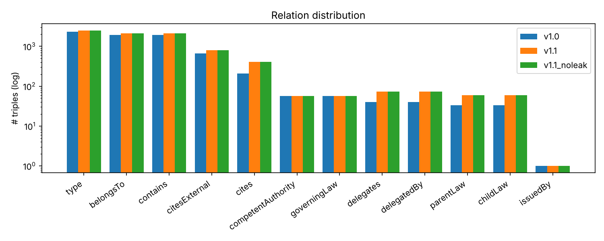

# defense_law_kg_dataset — 한국어 국방 법령 지식그래프 데이터셋

> 졸업논문 **Part 1 · 데이터셋 구축의 최종 산출물**
> 국방·방위사업 법령 41건에서 만든 한국어 지식그래프입니다. 논문 실험에 쓴 **v1.0**, 파서·정규화를 개선한 **v1.1**, 역관계 누수를 없앤 **v1.1_noleak** 세 가지 분할을 제공하고, 통계·품질 분석과 버전별 기준 성능을 함께 정리했습니다. 데이터 설명서는 [DATASHEET.md](DATASHEET.md)에 있습니다.

## 1. 한눈에 보기

| 항목 | v1.0 (논문) | v1.1 | v1.1_noleak |
|---|---|---|---|
| 트리플 | 7,354 | 8,327 | 8,327 |
| 엔티티 | 2,352 | 2,491 | 2,491 |
| 관계 | 12 | 12 | 12 |
| train / valid / test | 5,877 / 730 / 747 | 6,657 / 827 / 843 | 6,657 / 827 / 843 |
| 평균 / 중앙 / 최대 차수 | 6.25 / 3 / 1,936 | 6.69 / 3 / 2,129 | 같음 |
| test 콜드스타트 | 3.2% | 3.3% | 11.9% |
| **test 역관계 누수** | **80.7%** | **79.8%** | **0%** |

(역관계 누수 = 역관계가 있는 관계의 test 트리플 `(h,r,t)` 중 `(t,r⁻¹,h)`가 train에 있는 비율)



## 2. 파일 형식

```
data/<버전>/
├── train.tsv / valid.tsv / test.tsv                     # head_id \t relation_id \t tail_id
├── train_labeled.tsv / valid_labeled.tsv / test_labeled.tsv   # 사람이 읽는 이름 버전
├── entity2id.tsv / relation2id.tsv                      # 이름 \t id (빈도 내림차순)
└── triples_all.json                                     # [head, relation, tail] 전체 (v1.0, v1.1)
```

OpenKE · PyKEEN 등 일반 KGE 라이브러리 형식과 같아서 바로 불러 쓸 수 있습니다.

```
방위사업법 시행령 제12조	소속	방위사업법 시행령
방위사업법 시행령	상위법령	방위사업법
군수품조달관리규정 제5조	인용	방위사업법 제20조
```

## 3. 폴더 구조

```
defense_law_kg_dataset/
├── DATASHEET.md                 # 데이터셋 설명서 (동기·구성·수집·전처리·용도·한계)
├── data/v1.0 · v1.1 · v1.1_noleak
├── kgdata/                      # splitter.py (층화 분할), io.py (ID 매핑·TSV 입출력)
├── kgekit/                      # 기준 성능 측정용 NumPy KGE 엔진
├── scripts/
│   ├── build_split.py           # 트리플 → 분할 (--no-inverse-leak)
│   ├── analyze.py               # 통계·누수·차수 분석 + 그림
│   ├── benchmark_versions.py    # 버전별 TransE/TransO/Ours 성능
│   └── noleak_ablation.py       # 누수 없는 분할에서 Ours 손실 ablation
├── results/                     # dataset_stats.md, benchmark_versions.md, noleak_ablation.md, figures/
└── tests/test_dataset.py
```

## 4. 실행 방법

```bash
python -m venv .venv && source .venv/bin/activate     # Windows: .venv\Scripts\activate
pip install -r requirements.txt

python scripts/build_split.py --triples data/v1.1/triples_all.json --out data/v1.1
python scripts/build_split.py --triples data/v1.1/triples_all.json --out data/v1.1_noleak --no-inverse-leak
python scripts/analyze.py                     # results/dataset_stats.md, figures/
python scripts/benchmark_versions.py          # 3버전 × 3모델 × 3seed (약 30분)
python scripts/noleak_ablation.py             # 약 10분
python -m pytest -q
```

## 5. 분석 결과

### 관계 분포 (전체 / test)

| 관계 | v1.0 | v1.1 |
|---|---|---|
| type | 2,346 / 236 | 2,484 / 249 |
| 소속 · 포함 | 1,936 / 195 (각) | 2,129 / 214 (각) |
| 외부인용 | 669 / 68 | 796 / 81 |
| 인용 | 206 / 22 | 406 / 42 |
| 위임 · 위임받음 | 40 / 4 (각) | 74 / 8 (각) |
| 상위법령 · 하위법령 | 33 / 4 (각) | 60 / 6 (각) |
| 소관기관 · 관할법령 | 57 / 7 (각) | 57 / 7 (각) |
| 발령기관 | 1 / 1 | 1 / 1 |

조문 소속·포함과 타입이 전체의 85%를 차지하고, 연구 대상인 인용·위임·계층 관계는 롱테일입니다. 차수 분포도 `Article` 클래스 노드(차수 1,936)와 대형 훈령 몇 개에 몰려 있습니다.

### 역관계 누수와 기준 성능

KGE 벤치마크 FB15k에서 지적된 문제(Toutanova & Chen, 2015)와 같은 현상이 이 데이터셋에도 있습니다. 소속↔포함처럼 역관계를 함께 넣어 만든 KG를 무작위로 나누면, test 트리플의 역방향 트리플이 train에 남아 사실상 답을 보고 푸는 셈이 됩니다. v1.0 test의 **약 45%**(역관계 보유 56% × 누수 81%)가 여기에 해당합니다.

| 버전 | 모델 | MRR | Hits@1 | Hits@10 | 방향성 MRR | 계층 MRR |
|---|---|---|---|---|---|---|
| v1.0 | TransE | 0.2838 ± 0.016 | 0.1934 | 0.4382 | 0.3722 | 0.3427 |
| v1.0 | TransO | 0.2451 ± 0.024 | 0.1410 | 0.4099 | 0.3147 | 0.2876 |
| v1.0 | **Ours** | **0.3172** ± 0.012 | 0.2068 | 0.4895 | 0.4148 | 0.4252 |
| v1.1 | TransE | 0.2492 ± 0.047 | 0.1520 | 0.4083 | 0.3247 | 0.3441 |
| v1.1 | TransO | 0.2218 ± 0.004 | 0.1129 | 0.3982 | 0.2704 | 0.3443 |
| v1.1 | **Ours** | **0.2706** ± 0.017 | 0.1380 | 0.4696 | 0.3335 | 0.3299 |
| v1.1_noleak | TransE | 0.0747 ± 0.023 | 0.0302 | 0.1599 | 0.0435 | 0.4560 |
| v1.1_noleak | **TransO** | **0.0967** ± 0.028 | 0.0449 | 0.1914 | 0.0495 | 0.3965 |
| v1.1_noleak | Ours | 0.0591 ± 0.005 | 0.0202 | 0.1283 | 0.0473 | 0.4680 |

(seed 42·43·44 평균. v1.0 수치는 seed 수가 달라 논문 표(5 seed)와 조금 다름)

#### 누수 없는 분할(v1.1_noleak)에서 Ours 손실 ablation (`results/noleak_ablation.md`)

| 구성 | MRR | Hits@1 | Hits@10 | 방향성 MRR | 계층 MRR |
|---|---|---|---|---|---|
| TransE | 0.0747 | 0.0302 | 0.1599 | 0.0435 | 0.4560 |
| TransO | **0.0967** | **0.0449** | **0.1914** | 0.0495 | 0.3965 |
| Ours (전체) | 0.0591 | 0.0202 | 0.1283 | 0.0473 | **0.4680** |
| − L_attr | 0.0686 | 0.0267 | 0.1418 | **0.0537** | 0.3228 |
| − L_type | 0.0661 | 0.0237 | 0.1455 | 0.0481 | 0.4036 |
| − L_dir | 0.0602 | 0.0172 | 0.1394 | 0.0474 | 0.3169 |
| − L_hier_attn | 0.0617 | 0.0192 | 0.1358 | 0.0477 | 0.3162 |

어느 손실을 빼도 전체 MRR은 Ours(전체)보다 조금 오르거나 비슷하고(차이는 seed 표준편차 0.02 이내), 계층 MRR은 손실 하나만 빼도 0.47 → 0.32 수준으로 떨어집니다.

### 해석

1. **v1.1은 v1.0보다 어렵습니다.** 같은 법령이 여러 노드로 갈라져 있던 것을 합치고 인용이 두 배로 늘면서 MRR이 0.03~0.05 내려갑니다. 그래도 모델 순위(Ours > TransE > TransO)는 같습니다.
2. **누수를 없애면 MRR이 0.25~0.32에서 0.06~0.10으로 크게 떨어지고, 모델 순위가 바뀝니다.** v1.0·v1.1에서 가장 좋던 Ours가 누수 없는 분할에서는 가장 낮습니다. 즉 **기본 분할에서 Ours의 이득 상당 부분은 역관계 정보를 활용한 데서 나왔을 가능성이 큽니다.**
3. **계층 관계 효과는 누수 없이도 남습니다.** 계층 MRR은 Ours가 가장 높고(0.468), L_hier_attn을 빼면 0.316으로 떨어집니다. 다만 계층 test 트리플이 12개라 표본이 작습니다.
4. **누수가 없을 때는 타입 제약만 쓰는 TransO가 가장 좋습니다.** 누수 없는 분할은 test 트리플의 12%가 train에 한 번도 안 나온 엔티티를 포함하는 콜드스타트라, 클래스 중심으로 모으는 L_type이 일반화에 도움이 되는 것으로 보입니다. Ours 하이퍼파라미터(δ=3.0 등)는 누수가 있는 valid 셋에서 고른 값이라, 누수 없는 valid로 다시 탐색하면 결과가 달라질 수 있습니다.
5. 이 결과는 논문의 한계로 반드시 적어야 하며, 후속 연구에서는 `v1.1_noleak`(또는 역관계를 학습 시에만 생성하는 방식)을 기본 평가 프로토콜로 쓰는 것이 맞습니다.

## 6. 관련 저장소

[law_pdf_parser](https://github.com/Ikuuuu/law_pdf_parser) → [owl_lite_schema](https://github.com/Ikuuuu/owl_lite_schema) → [law_triple_extraction](https://github.com/Ikuuuu/law_triple_extraction) → **defense_law_kg_dataset** → [kge_baseline_benchmark](https://github.com/Ikuuuu/kge_baseline_benchmark) · [ontology_constraint_kge](https://github.com/Ikuuuu/ontology_constraint_kge)

---
송재익 · 충북대학교 산업인공지능학과 석사과정 (2025254013)
